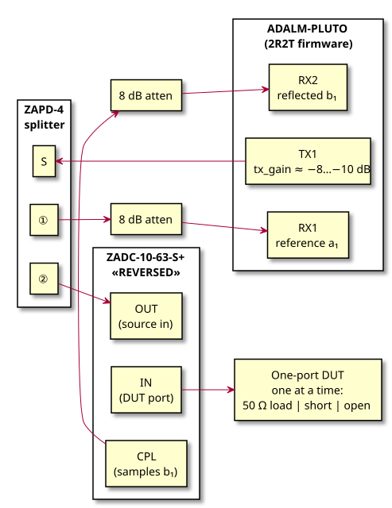

# pluto-vna

A vector network analyser built on an ADALM-PLUTO SDR, with a desktop GUI showing
log-magnitude, phase and a Smith chart over a swept frequency range.

**Target band: 2.5 – 4.2 GHz** (set by the RF parts, not the Pluto — see
[docs/hardware.md](docs/hardware.md)).

## Status

| Phase | What it delivers | State |
|-------|------------------|-------|
| 0. Bring-up | Pluto in 2R2T mode, host toolchain, coherent 2-channel capture | ☑ **done** |
| 1. Phase gate | Experiment: is TX↔RX phase repeatable across LO retunes? Picks the RF topology | ☑ **done** — reference channel required |
| 2. Sweep engine | Stepped-frequency CW sweep → raw complex ratio vs frequency (headless CLI) | ☑ **done** — 64 ms/point |
| 3. Calibration | SOL 1-port cal → corrected S11; through/isolation cal → S21 | ◐ in progress — 1-port solver done |
| 4. GUI | Live sweep, logmag/phase/VSWR traces, Smith chart, markers, cal wizard | ☐ not started |
| 5. Storage | Touchstone `.s1p`/`.s2p` export, save/load cal states | ☐ not started |
| 6. Full 2-port | S22/S12 by manual DUT reversal, full SOLT correction | ☐ not started |
| 7. Automation | RF switches for switch-less 4-parameter sweeps; multi-tone fast sweep | ☐ not started |

Legend: ☐ not started · ◐ in progress · ☑ done

## Todo

**Hardware — one-port test set** (details in [docs/hardware.md](docs/hardware.md) §5)



*One-port (S11) wiring as built. Source, regeneration commands and measurements in
[scratch/initial_setup.md](scratch/initial_setup.md).*

- [x] **Reverse the coupler** — feed `OUT`, DUT on `IN`
- [x] Insert the ZAPD-4 to create the reference channel into RX1
- [x] Pads: 8 dB on each RX port; TX level set in software (`tx_gain`) instead of a pad
- [ ] Dress the cables so nothing flexes between calibration and measurement
- [ ] Optional: a third pad between TX1 and the splitter, to improve the raw source
      match (currently as poor as −7.5 dB)

**Phase 0 — Bring-up** ☑
- [x] Enable 2R2T on the Pluto (`fw_setenv`) — RX2 now exists; range also opened to 70 MHz–6 GHz
- [x] Host toolchain: libiio built into the venv + pyadi-iio/PyQt6/pyqtgraph/scikit-rf
- [x] Confirm TX DDS tone out, both RX channels captured in one coherent buffer
- [x] Work around the intermittent dead-TX-at-startup fault (verified tone + ENSM kick)

**Phase 1 — Phase gate** ☑
- [x] Measure phase repeatability of a fixed path across repeated LO retunes
- [x] Decide topology → **reference channel required**, ZAPD-4 goes in the path

**Phase 2 — Sweep engine** ☑
- [x] Single-point measurement primitive (retune → settle → capture → coherent DFT → ratio)
- [x] Sweep loop, averaging, IF bandwidth control, uncalibrated CLI sweep + CSV out
- [x] Mock backend (known error box, random LO phase) + tests

**Phase 3 — Calibration** ◐
- [x] Cal-kit definition file (open/short/load with offset delay) — `calkits/ideal.toml`
- [x] 3-term SOL solver + settings-locked cal state, applied to saved sweeps (`cli cal` / `cli correct`)
- [ ] Apply the cal to live sweeps
- [ ] Through normalisation + isolation cal for S21
- [ ] Verify: known-good DUT, cal stability over time

**Phase 4 — GUI**
- [ ] Sweep control panel (freq, points, IF BW, power, gain, averaging)
- [ ] Trace views: logmag / phase / VSWR / group delay
- [ ] Smith chart widget with markers
- [ ] Cal wizard, single/continuous sweep, live update

**Phase 5 — Storage**
- [ ] Touchstone export/import, cal state save/load, sweep snapshots

**Phase 6 — Full 2-port**
- [ ] S22/S12 via DUT reversal, 8-term/SOLT correction, `.s2p` output

**Phase 7 — Automation** *(future)*
- [ ] Second coupler + absorptive SPDT switches → all 4 parameters, no recabling
- [ ] Multi-tone comb sweep for ~10× faster sweeps

## Docs

- [docs/setup.md](docs/setup.md) — firmware change and venv setup, reproducible from scratch
- [docs/hardware.md](docs/hardware.md) — RF topology, band limits, level budget, and the
  recommended hardware for S21/S22
- [docs/design.md](docs/design.md) — measurement theory, error model, software architecture
- [project_outline.md](project_outline.md) — original goals

```sh
.venv/bin/python tools/bringup.py info | spectrum | phasegate
.venv/bin/python -m plutovna.cli sweep --points 201 --out data/load.csv   # raw sweep
.venv/bin/python -m plutovna.cli sweep --mock short                       # no hardware
.venv/bin/python -m plutovna.cli cal                    # data/{open,short,load}.csv → data/cal.npz
.venv/bin/python -m plutovna.cli correct data/dut.csv --out data/dut_gamma.csv
.venv/bin/python -m pytest -q tests
```

## Key findings so far

- The Pluto was in **1R1T** mode — `RX2`/`TX2` were wired but invisible to software. Fixed
  via `fw_setenv`; that also opened the tuning range to **70 MHz–6 GHz** and halved the max
  sample rate to 30.72 MSPS.
- The **ZADC-10-63-S+ is 2.5–6 GHz**, not 2–6 GHz. With the ZAPD-4 (2–4.2 GHz) in the
  reference path the usable band is **2.5–4.2 GHz**.
- As cabled, the coupler's `CPL` port samples the **forward** wave, not the reflected one —
  an incident-power reference, not a reflectometer. Measured: RX2 sits 44 dB below RX1 with
  a one-port standard attached, exactly as that analysis predicts. Reversing the coupler
  fixes it.
- **TX and RX LO phase is random on every retune**, so absolute phase is unusable: measured
  circular std 87–164° per channel, but only **1.2–3.6° for the RX2/RX1 ratio**. Every
  measured quantity must be a ratio of two simultaneously captured receivers — which is
  what forces a reference channel into the test set.
- The AD9363 **TX comes up muted about ⅔ of the time** after a fresh context, with every
  register reading back correct. Cycling the ENSM `alert`→`fdd` and re-issuing the DDS
  fixes it; `tools/bringup.py` verifies the tone before returning (10/10 cold starts).
- The DDS **quantizes its tone frequency** (1 000 000 Hz requested → 999 953 Hz), so the
  estimator correlates at the *measured* frequency. Both channels use the same reference,
  so leakage cancels in the ratio.
