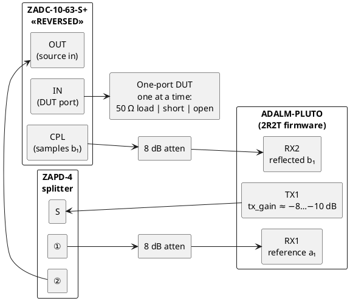
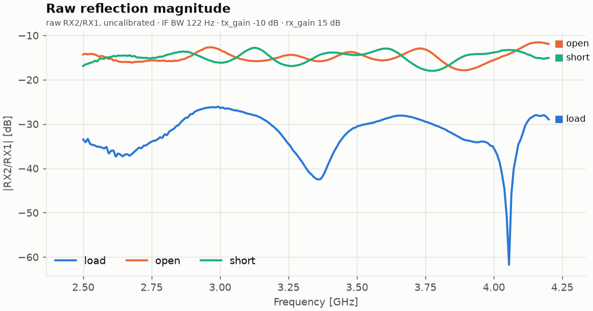
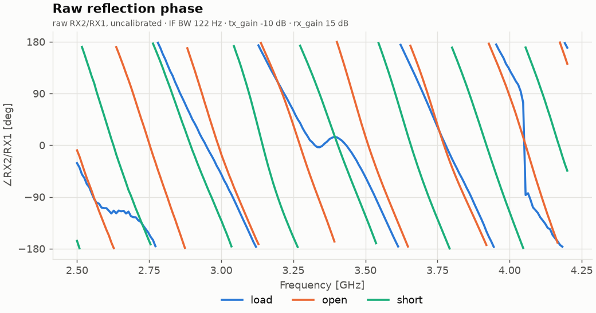
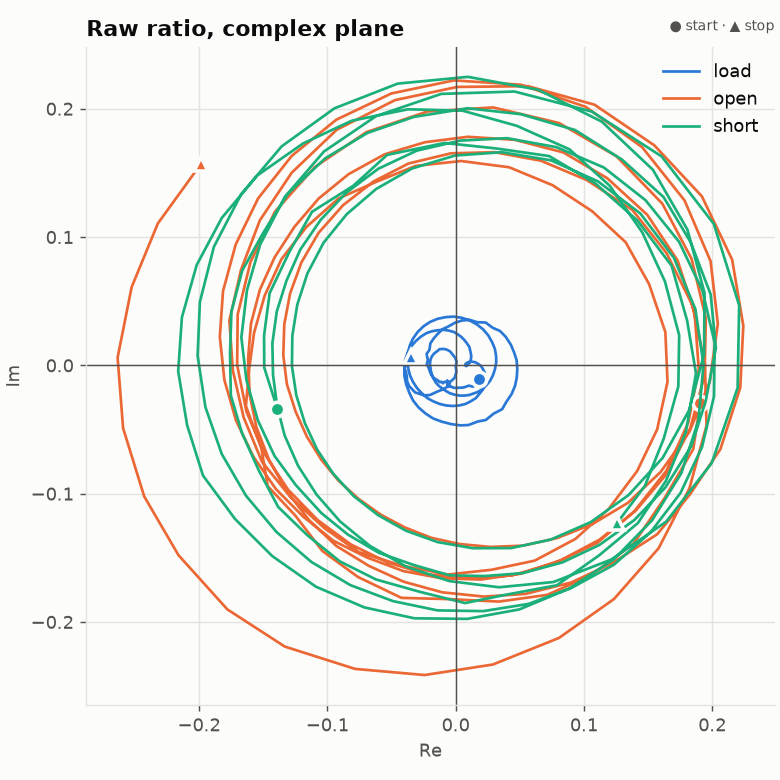
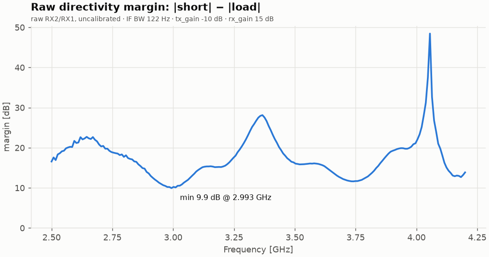
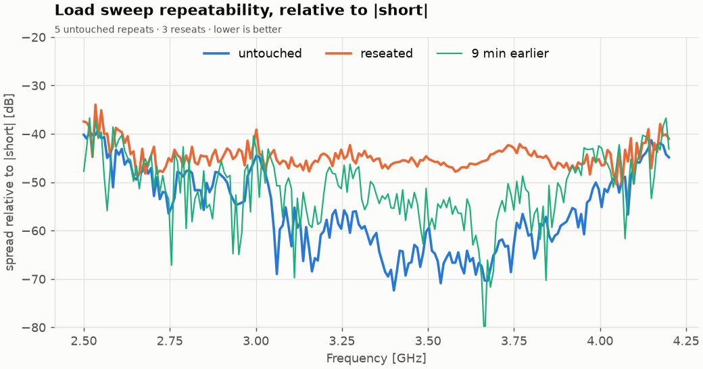
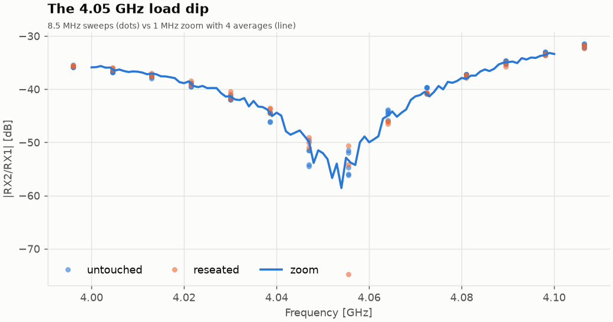
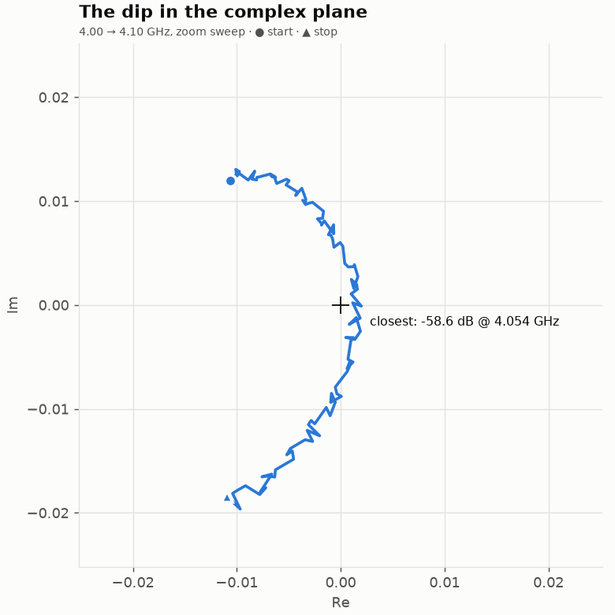

# Initial setup used for the pluto SDR VNA

One-port (S11) setup, following `docs/hardware.md` §5 position ① (single coupler, coupler
reversed). It uses only two attenuators: the TX pad is replaced by the Pluto's TX
attenuation (`tx_hardwaregain_chan0` ≈ −8 to −10 dB), and the two pads sit on the RX ports.

- Every cable is permanent. Only the standard on the coupler's `IN` port changes.
- The DUT port is coupler `IN`. For calibration, screw on the 50 Ω load, the short or the
  open, one at a time. After calibration, the device under test goes there instead.
- RX2/RX1 = b₁/a₁ = raw S11.



## Bringup
Running 
```shell
for rf in 2.6e9 3.0e9 3.5e9 4.0e9; do
  .venv/bin/python tools/bringup.py spectrum --rf $rf | grep -E "rms|RX2/RX1"
done
``` 

once for each standard on the DUT port gives the results below. Default settings:
`tx_gain=-10`, `rx_gain=20` on both channels, fs = 4 MSPS, N = 32768, IF = 1 MHz. The RX
levels are capture RMS in LSB (12-bit, full scale ≈ 2048).

| RF [GHz] | Standard | RX1 rms [LSB] | RX2 rms [LSB] | \|RX2/RX1\| [dB] | ∠RX2/RX1 [deg] |
|---:|---|---:|---:|---:|---:|
| 2.6 | Load  | 463.1 |  6.7 | −37.06 | −115.57 |
| 2.6 | Open  | 441.6 | 77.0 | −15.17 | −144.69 |
| 2.6 | Short | 447.3 | 81.1 | −14.84 |  +41.52 |
| 3.0 | Load  | 338.7 | 16.2 | −26.47 |  −51.80 |
| 3.0 | Open  | 344.2 | 75.1 | −13.22 |  −15.54 |
| 3.0 | Short | 308.5 | 48.0 | −16.16 | −130.71 |
| 3.5 | Load  | 292.3 |  8.7 | −30.64 |  −54.80 |
| 3.5 | Open  | 246.9 | 48.9 | −14.07 |  +14.56 |
| 3.5 | Short | 332.7 | 63.1 | −14.44 | −123.22 |
| 4.0 | Load  | 220.9 |  3.8 | −35.99 | +129.49 |
| 4.0 | Open  | 214.0 | 35.8 | −15.55 |  +85.96 |
| 4.0 | Short | 229.2 | 46.2 | −13.91 | −117.08 |

### Derived (raw, uncalibrated)

| RF [GHz] | Short − Load [dB] | Open − Short magnitude [dB] | Open − Short phase [deg] |
|---:|---:|---:|---:|
| 2.6 | 22.2 | −0.33 | +173.8 |
| 3.0 | 10.3 | +2.94 | +115.2 |
| 3.5 | 16.2 | +0.37 | +137.8 |
| 4.0 | 22.1 | −1.64 | −157.0 |

"Short − Load" is the raw directivity margin: how far the load reading sits below the
short. An ideal open and short are equal in magnitude and 180° apart.

## Raw sweeps (Phase 2)

201-point sweeps of each standard, 2.5–4.2 GHz, taken with

```shell
for std in load open short; do
  read -p "Attach $std, press enter"
  .venv/bin/python -m plutovna.cli sweep --rx-gain 15 -q --out data/$std.csv
done
```

Settings: fs = 4 MSPS, N = 32768 (IF BW 122 Hz), IF = 1 MHz, `tx_gain=-10`,
`rx_gain=15` on both channels, 1 average. Each sweep took about 12 s.

| File | Standard | Notes |
|---|---|---|
| `data/load.csv` | 50 Ω load | |
| `data/open.csv` | open | |
| `data/short.csv` | short | |
| `data/short_rxgain20.csv` | short | Same sweep at `rx_gain=20`. Taken by mistake while the short was still on (the load was intended), kept for the gain comparison below. |

Every CSV starts with `# key = value` lines recording the sweep plan and radio settings,
then one row per point: `freq_hz, re, im, mag_db, phase_deg, sem, a1_dbfs, a2_dbfs,
ref_snr_db`. `re`/`im` are the raw complex RX2/RX1 ratio. Read them back with
`plutovna.sweep.SweepResult.from_csv`.

Regenerate the plots with:

```shell
.venv/bin/python tools/plot_raw.py          # reads data/{load,open,short}.csv → scratch/img/
```

### Summary

| Quantity | Value |
|---|---|
| \|load\| | −61.7 … −26.1 dB, mean −32.4 dB |
| \|open\| | −17.9 … −11.6 dB, mean −14.9 dB |
| \|short\| | −18.0 … −12.8 dB, mean −14.9 dB |
| Short − load margin | min 9.9 dB @ 2.993 GHz, median 16.5 dB, max 48.4 dB |
| Open − short phase | 113 … 180° |
| Electrical delay (open/short phase slope) | 3.9 ns |
| Strongest tone | RX1 −16.4 dBFS (≥ 15 dB headroom ✔) |
| Reference-tone SNR | ≥ 78.2 dB on every point (TX never dropped out) |
| Short at `rx_gain` 20 vs 15 | ratio differs by up to 0.45 dB / 3.0° |

### Magnitude



Open and short sit at the same mean level (−14.9 dB). Their ripple runs in *antiphase*:
where one peaks the other dips. That is the source-match term `e₁₁` at work. It
re-reflects the DUT's wave, and because Γ flips sign between open and short, the
re-reflection adds to one and subtracts from the other. The load trace is the raw
directivity `e₀₀` (the coupler's leakage, plus whatever the load reflects). The sharp
null at 4.05 GHz is where those two components happen to cancel.

### Phase



Open and short wrap about every 260 MHz, about 3.9 ns of round-trip electrical delay
from the cables and coupler. They stay roughly 180° apart. The load's phase wanders and
jumps by 180° at the 4.05 GHz null, as expected for a small vector passing near zero.

### Complex plane



This is what the calibration solver works on. Open and short trace overlapping circles
of radius ≈ 0.18, roughly centred on the load's small cluster (|e₀₀| ≲ 0.05). The
3-term SOL calibration maps those three traces back onto Γ = +1, −1 and 0.

### Directivity margin



The worst point is again around 3.0 GHz (9.9 dB), matching the spot checks at the top of
this file. It's stable error, so calibration removes it. But this is where the
calibrated result will be most sensitive to drift and cable movement.

### Gain changes the ratio

The short measured at `rx_gain=20` and at `rx_gain=15` differs by up to 0.45 dB and 3°.
The two receivers don't track each other perfectly across gain settings. So a
calibration is only valid at the RX gain it was taken with, which is why every CSV
records the settings.

## Repeatability of the load sweep

With the load attached, taken at 22:22–22:25. Same settings as above (`rx_gain=15`):

```shell
# 1. untouched: 5 back-to-back sweeps
for i in 1 2 3 4 5; do
  .venv/bin/python -m plutovna.cli sweep --rx-gain 15 -q --out data/load_rep$i.csv
done
# 2. reseated: unscrew and reattach the load before each of 3 sweeps
for i in 1 2 3; do
  read -p "Unscrew and reattach the load, press enter"
  .venv/bin/python -m plutovna.cli sweep --rx-gain 15 -q --out data/load_reseat$i.csv
done
# 3. zoom on the dip: 1 MHz steps, 4 averages
.venv/bin/python -m plutovna.cli sweep --rx-gain 15 -q --start 4.0e9 --stop 4.1e9 \
  --points 101 --avg 4 --out data/load_zoom.csv
```

Regenerate the plots with `.venv/bin/python tools/plot_repeats.py`.

All spreads below are **complex** differences, expressed relative to |short| (≈ 0.18).
That reads as "how far below a full reflection is the error", which is what limits a
calibrated measurement. Comparing dB values directly would mislead near the dip, where a
tiny complex change swings the dB reading by 20 dB.

| Comparison | Median | Worst |
|---|---|---|
| Untouched repeats (std of 5) | −56.5 dB | −39.2 dB @ 2.54 GHz |
| Reseated (std of 3) | −45.1 dB | −34.0 dB |
| Original `load.csv`, 9 min earlier, vs mean of repeats | −51.3 dB | −36.7 dB @ 2.52 GHz |
| Zoom: point-to-point jitter about a smooth fit | −49.0 dB | |
| Zoom: within-point noise (standard error of 4 captures) | −80 dB | |



### The dip is real and harmless





- Every one of the 9 sweeps puts the minimum at the **same frequency, 4.0555 GHz**. The
  zoom puts it at 4.054 GHz.
- In the complex plane the load's trace is a smooth arc that happens to pass within
  ≈ 0.001 of the origin. The leakage `e₀₀` and the load's own small reflection are equal
  and opposite there.
- The *depth* varies between −50 and −75 dB from sweep to sweep. That is only the
  ≈ 0.001 jitter below, landing slightly closer to or further from zero.

The calibration subtracts `e₀₀` as a complex number, so a near-zero raw value is not a
problem.

### The real finding: jitter per retune, not noise

In the zoom sweep, the 4 captures at each frequency agree to a standard error of
1.8 × 10⁻⁵. But neighbouring frequencies scatter about a smooth curve by 6.4 × 10⁻⁴ rms,
**35× more**. So the ratio picks up a small random error every time the LO is retuned,
and it stays fixed until the next retune. That means:

- **`--avg` doesn't help with it.** It averages captures without retuning.
- **The jitter, not receiver noise, sets the floor** of about −49 to −56 dB relative to a
  full reflection.
- It's worst at the band edges (−40 dB at 2.5–2.6 GHz and 4.0–4.2 GHz). That's where the
  untouched spread rises in the plot above.

This matches the residual 1–3.6° ratio scatter in the Phase 1 phase-gate experiment
(`docs/hardware.md` §4). That was blamed on low RX2 SNR at the time, but SNR is now
≥ 78 dB and the scatter is still there.

#### Additive, not multiplicative

Is the jitter a fixed-size error added to the ratio, or a gain/phase step that scales
with it? The same zoom sweep with the short attached (22:30) answers it:

```shell
.venv/bin/python -m plutovna.cli sweep --rx-gain 15 -q --start 4.0e9 --stop 4.1e9 \
  --points 101 --avg 4 --out data/short_zoom.csv
```

| Zoom, 4.0–4.1 GHz | Load | Short |
|---|---|---|
| Median \|ratio\| | 0.0103 | 0.2113 (20× larger) |
| Point-to-point jitter, rms | 6.4 × 10⁻⁴ | 5.5 × 10⁻⁴ |
| … relative to \|short\| | −49.0 dB | −50.2 dB |
| … split radial / tangential | 4.5 / 4.6 × 10⁻⁴ | 3.8 / 4.0 × 10⁻⁴ |
| … as gain/phase of its own signal | 0.83 dB / 5.8° | **0.016 dB / 0.11°** |
| Within-point standard error (4 captures) | 1.8 × 10⁻⁵ | 2.8 × 10⁻⁵ |

The signal is 20× larger on the short, but the jitter is the same size. So it's
**additive**: a small vector of ≈ 6 × 10⁻⁴ with a random phase per retune (the radial
and tangential parts are equal), added to whatever is being measured. Any
multiplicative part is below 0.016 dB / 0.11°, so tracking is excellent.

What it means for calibration:

- It acts like a random directivity error of about **−50 dB relative to a full
  reflection** near 4 GHz, and about −56 dB mid-band. That's the floor for measuring
  return loss after calibration, the same order as the −45 dB reseat error. Both are
  fine for a hobby VNA.
- Strong reflections (open, short, mismatched DUTs) are barely affected. Only
  well-matched DUTs (return loss > 40 dB) will look noisy.
- Averaging over retunes (sweeping several times, or retuning between averages) would
  cut it by √K. Averaging captures at a fixed tune does nothing.

### Reseating

A reseat costs about −45 dB, flat across the band. This is the error each standard swap
adds during calibration. It's about 10 dB worse than the untouched repeats in mid-band,
so a torque wrench (or at least a consistent hand tightness) is worth it.
