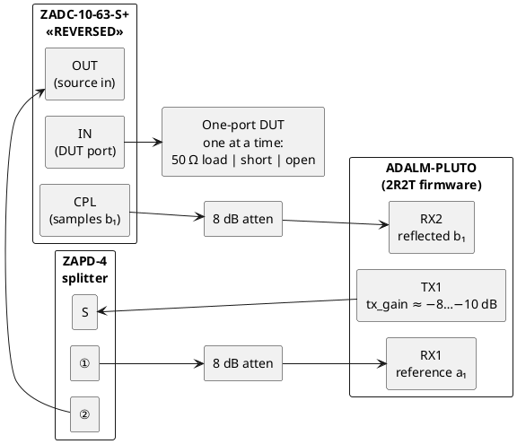

# Initial setup used for the pluto SDR VNA

One-port (S11) setup, following `docs/hardware.md` §5 position ① (single coupler, coupler
reversed). It uses only two attenuators: the TX pad is replaced by the Pluto's TX
attenuation (`tx_hardwaregain_chan0` ≈ −8 to −10 dB), and the two pads sit on the RX ports.

- Every cable is permanent. Only the standard on the coupler's `IN` port changes.
- The DUT port is coupler `IN`. For calibration, screw on the 50 Ω load, the short or the
  open, one at a time. After calibration, the device under test goes there instead.
- RX2/RX1 = b₁/a₁ = raw S11.



## Bringup
Running 
```shell
for rf in 2.6e9 3.0e9 3.5e9 4.0e9; do
  .venv/bin/python tools/bringup.py spectrum --rf $rf | grep -E "rms|RX2/RX1"
done
``` 

once for each standard on the DUT port gives the results below. Default settings:
`tx_gain=-10`, `rx_gain=20` on both channels, fs = 4 MSPS, N = 32768, IF = 1 MHz. The RX
levels are capture RMS in LSB (12-bit, full scale ≈ 2048).

| RF [GHz] | Standard | RX1 rms [LSB] | RX2 rms [LSB] | \|RX2/RX1\| [dB] | ∠RX2/RX1 [deg] |
|---:|---|---:|---:|---:|---:|
| 2.6 | Load  | 463.1 |  6.7 | −37.06 | −115.57 |
| 2.6 | Open  | 441.6 | 77.0 | −15.17 | −144.69 |
| 2.6 | Short | 447.3 | 81.1 | −14.84 |  +41.52 |
| 3.0 | Load  | 338.7 | 16.2 | −26.47 |  −51.80 |
| 3.0 | Open  | 344.2 | 75.1 | −13.22 |  −15.54 |
| 3.0 | Short | 308.5 | 48.0 | −16.16 | −130.71 |
| 3.5 | Load  | 292.3 |  8.7 | −30.64 |  −54.80 |
| 3.5 | Open  | 246.9 | 48.9 | −14.07 |  +14.56 |
| 3.5 | Short | 332.7 | 63.1 | −14.44 | −123.22 |
| 4.0 | Load  | 220.9 |  3.8 | −35.99 | +129.49 |
| 4.0 | Open  | 214.0 | 35.8 | −15.55 |  +85.96 |
| 4.0 | Short | 229.2 | 46.2 | −13.91 | −117.08 |

### Derived (raw, uncalibrated)

| RF [GHz] | Short − Load [dB] | Open − Short magnitude [dB] | Open − Short phase [deg] |
|---:|---:|---:|---:|
| 2.6 | 22.2 | −0.33 | +173.8 |
| 3.0 | 10.3 | +2.94 | +115.2 |
| 3.5 | 16.2 | +0.37 | +137.8 |
| 4.0 | 22.1 | −1.64 | −157.0 |

"Short − Load" is the raw directivity margin: how far the load reading sits below the
short. An ideal open and short are equal in magnitude and 180° apart.

## Raw sweeps (Phase 2)

201-point sweeps of each standard, 2.5–4.2 GHz, taken with

```shell
for std in load open short; do
  read -p "Attach $std, press enter"
  .venv/bin/python -m plutovna.cli sweep --rx-gain 15 -q --out data/$std.csv
done
```

Settings: fs = 4 MSPS, N = 32768 (IF BW 122 Hz), IF = 1 MHz, `tx_gain=-10`,
`rx_gain=15` on both channels, 1 average. Each sweep took about 12 s.

| File | Standard | Notes |
|---|---|---|
| `data/load.csv` | 50 Ω load | |
| `data/open.csv` | open | |
| `data/short.csv` | short | |
| `data/short_rxgain20.csv` | short | Same sweep at `rx_gain=20`. Taken by mistake while the short was still on (the load was intended), kept for the gain comparison below. |

Every CSV starts with `# key = value` lines recording the sweep plan and radio settings,
then one row per point: `freq_hz, re, im, mag_db, phase_deg, sem, a1_dbfs, a2_dbfs,
ref_snr_db`. `re`/`im` are the raw complex RX2/RX1 ratio. Read them back with
`plutovna.sweep.SweepResult.from_csv`.

Regenerate the plots with:

```shell
.venv/bin/python tools/plot_raw.py          # reads data/{load,open,short}.csv → scratch/img/
```

### Summary

| Quantity | Value |
|---|---|
| \|load\| | −61.7 … −26.1 dB, mean −32.4 dB |
| \|open\| | −17.9 … −11.6 dB, mean −14.9 dB |
| \|short\| | −18.0 … −12.8 dB, mean −14.9 dB |
| Short − load margin | min 9.9 dB @ 2.993 GHz, median 16.5 dB, max 48.4 dB |
| Open − short phase | 113 … 180° |
| Electrical delay (open/short phase slope) | 3.9 ns |
| Strongest tone | RX1 −16.4 dBFS (≥ 15 dB headroom ✔) |
| Reference-tone SNR | ≥ 78.2 dB on every point (TX never dropped out) |
| Short at `rx_gain` 20 vs 15 | ratio differs by up to 0.45 dB / 3.0° |

### Magnitude


Open and short sit at the same mean level (−14.9 dB). Their ripple runs in *antiphase*:
where one peaks the other dips. That is the source-match term `e₁₁` at work. It
re-reflects the DUT's wave, and because Γ flips sign between open and short, the
re-reflection adds to one and subtracts from the other. The load trace is the raw
directivity `e₀₀` (the coupler's leakage, plus whatever the load reflects). The sharp
null at 4.05 GHz is where those two components happen to cancel.

### Phase


Open and short wrap about every 260 MHz, about 3.9 ns of round-trip electrical delay
from the cables and coupler. They stay roughly 180° apart. The load's phase wanders and
jumps by 180° at the 4.05 GHz null, as expected for a small vector passing near zero.

### Complex plane


This is what the calibration solver works on. Open and short trace overlapping circles
of radius ≈ 0.18, roughly centred on the load's small cluster (|e₀₀| ≲ 0.05). The
3-term SOL calibration maps those three traces back onto Γ = +1, −1 and 0.

### Directivity margin


The worst point is again around 3.0 GHz (9.9 dB), matching the spot checks at the top of
this file. It's stable error, so calibration removes it. But this is where the
calibrated result will be most sensitive to drift and cable movement.

### Gain changes the ratio

The short measured at `rx_gain=20` and at `rx_gain=15` differs by up to 0.45 dB and 3°.
The two receivers don't track each other perfectly across gain settings. So a
calibration is only valid at the RX gain it was taken with, which is why every CSV
records the settings.
